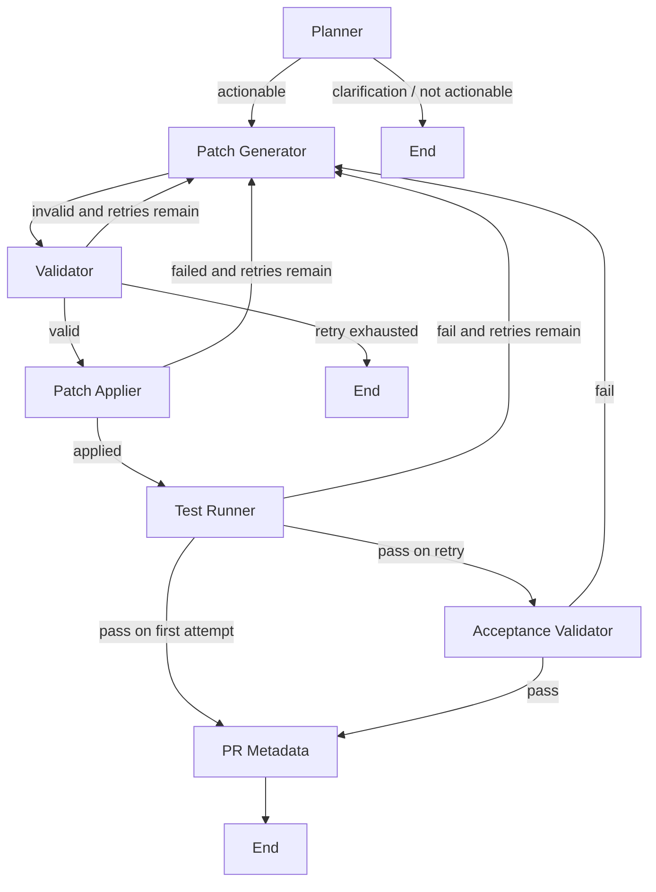

# Design and Engineering Decisions

## 1. Separation of Concerns

The system deliberately uses separate languages and services:

- **Node.js** is responsible for API durability, GitHub access, run persistence, Socket.IO updates, and PR publication.
- **Python/FastAPI** is responsible for repository analysis and LLM-driven repair logic.
- **React** is a presentation and review client, not a source of repair authority.

This boundary makes GitHub publication and data persistence controllable by the backend while keeping LLM orchestration in a focused agent process.

## 2. LangGraph Repair Pipeline

The agent is modeled as a state machine rather than one monolithic LLM call. This provides explicit stages, retry routing, partial state preservation, and execution telemetry.

The graph has a maximum retry count of three. Each patch attempt increments `retry_count`, records stage-specific errors, and can feed failure output into the next prompt.

## 3. Context Reduction

Repository context is limited before it reaches an LLM:

- Repository traversal ignores `.git`, dependencies, virtual environments, build output, and cache directories.
- Only supported source extensions are ranked for issue relevance.
- Files larger than 200 KB are excluded.
- At most six source files plus one test file are selected.
- Relevant file content is read with bounded limits.
- The planner receives skeletonized code for at most three files.
- The patch prompt uses only the current file, a short issue/plan representation, a maximum of five related filenames, and compact execution feedback.

This is a cost and latency control, not a guarantee of perfect repository understanding.

## 4. AST and Skeleton Strategy

Python source is parsed by Python's real `ast` module and transformed to:

- module-level imports and declarations retained by normal AST parsing;
- function and async-function signatures retained;
- function docstrings retained;
- function implementation bodies collapsed to `...`;
- class docstrings, nested definitions, and class-level assignments retained;
- class implementation details collapsed.

For non-Python and unsupported files, a line-based generic skeletonizer keeps declarations, imports, comments, and a small number of structural lines. The implementation is documented in detail in [AST_AND_SKELETON_LOGIC.md](AST_AND_SKELETON_LOGIC.md).

## 5. Patch Strategy

Patches are generated as complete file contents, not line-spliced fragments. The generator:

1. Builds a provider-specific Pydantic-structured prompt.
2. Processes the primary source file and, when appropriate, one test file.
3. Uses a provider-sensitive concurrency limit.
4. Rejects known hallucinated truncation markers.
5. Computes a unified diff from Git.
6. Resets the target repository after synthesis to avoid retaining transient edits.

A subsequent patch-applier stage uses exact and fuzzy matching to handle indentation drift and line-offset differences.

## 6. Validation Strategy

Patch validation checks:

- non-empty output;
- valid unified-diff headers;
- at least one changed file;
- all changed files belong to the selected allowlist;
- at least one changed file is a source file rather than a test.

Test detection prioritizes:

- pytest files/configuration;
- package `test` scripts;
- fallback pytest for Python repositories;
- no-test success when no runnable test system is detected.

The test runner has a 30-second timeout. Retry passes can target a modified test file for a faster feedback loop.

## 7. LLM Provider and Fallback Design

Provider configuration is centralized in `agent/config.py`.

- Gemini uses an API key and configurable model, temperature, token limit, and pacing.
- Ollama uses a local HTTP endpoint and configurable model/context size.
- NVIDIA Nemotron is implemented as an additional provider.
- Provider fallback and response caching are managed by `agent/llm/llm_provider.py`.

API keys are not stored in source; `.env` files are ignored, while `.env.example` files document configuration names.

## 8. Security and Isolation

The current design has several defensive controls:

- FastAPI middleware verifies `x-api-key` for protected endpoints.
- Callback URLs are restricted to configured HTTP(S) hosts.
- Express API routes require a backend API key.
- CORS is configured by environment.
- Helmet and compression protect the HTTP layer.
- Target repository operations use GitPython/simple-git with cleanup and reset logic.
- GitHub PRs can be draft PRs by default.

These controls are application-level guards. The test runner still executes target-repository commands locally and should run in a container or microVM for untrusted repositories.
