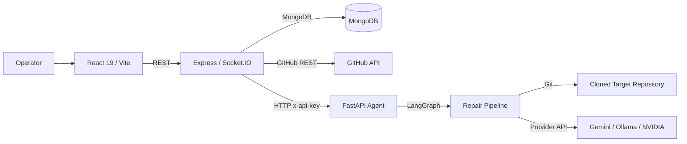
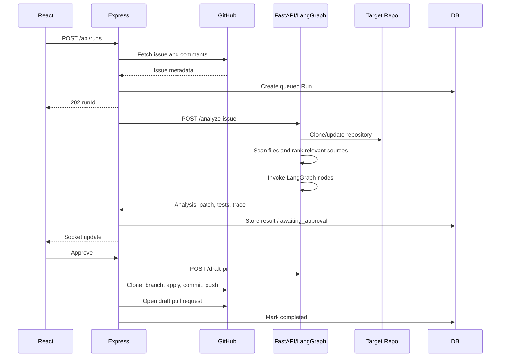

# System Architecture

## 1. Overview

OSA/Sentra AI is a three-tier application for converting a GitHub issue into an automated, human-reviewed pull request:

1. **React dashboard** - creates and monitors runs and provides approve, retry, reject, and delete actions.
2. **Node.js orchestration service** - stores run state, calls GitHub and the Python agent, and publishes real-time events.
3. **Python LangGraph agent** - clones the target repository, selects relevant files, plans a fix, generates and validates a patch, runs tests, and prepares PR metadata.

## 2. Runtime Components

### React frontend

- Entry routing is declared in `frontend/src/App.jsx`.
- `/` creates runs, `/history` lists runs, and `/runs/:id` displays details and HITL controls.
- `frontend/src/services/runService.js` maps UI actions to backend REST endpoints.
- `frontend/src/hooks/useRun.js` loads run state and performs silent refreshes.
- `RunDetails.jsx` listens to `run:update` and `run:event` Socket.IO events and refreshes the run.

### Node.js backend

- `backend/index.js` creates the HTTP server, Socket.IO server, MongoDB connection, and graceful shutdown handlers.
- `backend/app.js` configures Helmet, compression, CORS, JSON limits, API-key middleware, routes, and centralized error handling.
- `backend/routes/run.route.js` exposes run CRUD and human-review endpoints.
- `backend/controllers/run.controller.js` translates HTTP requests into service calls.
- `backend/services/run.service.js` owns run lifecycle and HITL actions.
- `backend/services/runProcessor.js` performs asynchronous agent invocation and status updates.
- `backend/services/agent.service.js` invokes the Python FastAPI service.
- `backend/services/github.service.js` fetches issues and creates branches, commits, pushes, and pull requests.
- `backend/models/run_schema.js` persists run state and telemetry.

### Python agent

- `agent/main.py` exposes FastAPI endpoints and validates `x-api-key`.
- `agent/services/context_service.py` orchestrates cloning, repository scanning, relevance ranking, and LangGraph execution.
- `agent/agents/planner_graph.py` compiles the repair state machine.
- `agent/agents/state.py` defines the shared `AgentState` data contract.
- `agent/git_utils/` isolates target-repository operations and context extraction.
- `agent/llm/` provides provider selection, clients, fallback, and caching.
- `agent/prompts/` constructs planner and patch-generation prompts.

## 3. Primary Execution Flow

## 4. Run State Model

The MongoDB run status is a fixed enum:

`queued -> running -> awaiting_approval -> publishing -> completed`

Failure and human-review branches are also supported:

- `running -> failed`
- `awaiting_approval -> rejected`
- `awaiting_approval -> running` for retry
- `publishing -> awaiting_approval` when PR publishing rolls back

A run stores repository metadata, issue data, reviews, timestamps, result, PR metadata, errors, and mixed execution trace events.

## 5. Human-in-the-Loop Boundary

No PR is opened automatically after patch synthesis. The backend requires the run to reach `awaiting_approval` and exposes:

- **Approve** - optionally includes reviewer notes and requests a draft PR.
- **Retry** - records feedback and restarts the LangGraph pipeline with the previous result.
- **Reject** - records a rejection and stops the run.
- **Delete** - removes the MongoDB run document.

The PR is created as a draft unless the agent metadata or caller explicitly changes that option.
